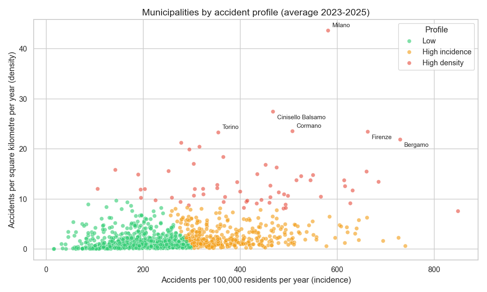
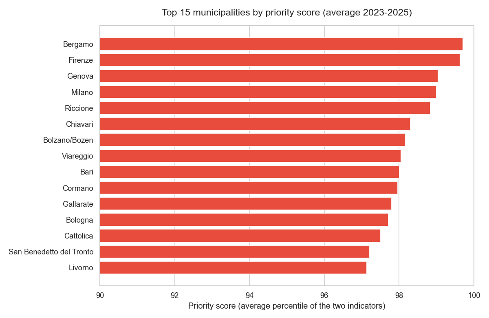

# Road accidents in Italy: where to invest in safety

Capstone Project for the Master in Data Analytics at Boolean, an Italian tech training school, submitted in August 2026.

> **Version 2, November 2026.** This is a revision I made after the course, to practise and improve. I reread the project I had submitted, found some mistakes and fixed them. The list of what changed, and why, is at the bottom. The submitted version is still in the repository history, at commit `0a4afcc`.

**The question:** in the course brief, a company that works on traffic and prevention wants to know in which Italian municipalities it makes sense to invest in road safety. It needs up-to-date numbers that can be compared between large and small municipalities, and a dashboard that presents the result.

**The answer, in short:** I downloaded the accident data from ISTAT, the Italian national statistics institute, and joined it with the population and area of each municipality. I split the 1,202 municipalities with more than 10,000 residents into three profiles: **772 Low, 369 High incidence, 61 High density**, meaning low accident levels, many accidents per resident and many accidents per square kilometre. Then I ranked them with a priority score. At the top are Bergamo, Firenze, Genova, Milano and Riccione. Profiles and score use the average of the last three years, 2023 to 2025.

The numbers are for 2025, the latest year published by ISTAT: 177,207 accidents with injuries, 2,868 deaths, 237,822 injured.



## What is inside

| File | What it contains |
| --- | --- |
| `main.ipynb` | The whole analysis in Python: download, cleaning, exploration, indicators, clustering, priority |
| `Dashboard.pbix` | The Power BI dashboard, updated to the data of this revision. Three pages: the overview, the map of the profiles and the priority ranking (`Where to Invest`), with filters by profile and by region |
| `Slide deck capstone project.pptx` | The five slides of the presentation, updated to the numbers of this revision |
| `data/raw/` | The data as it comes from ISTAT and SITUAS (ISTAT's information system for administrative and territorial units) |
| `data/clean/` | The datasets produced by the notebook, up to the one with profiles and priority. If you read them with pandas: the province code of Napoli is `NA`, which `read_csv` takes for a missing value unless you pass `keep_default_na=False` |
| `images/` | The charts saved by the notebook. Two of them are on this page |
| `requirements.txt` | The libraries used by the notebook, with the versions it was run with |

## How I worked

1. **ISTAT data downloaded automatically.** The notebook calls the ISTAT SDMX endpoint. The server is slow, so it only asks for the years from the last one already saved onwards and adds them to the rest. Every response is checked before writing: if the download fails, the analysis starts again from the saved file and says so.
2. **Three measures per municipality and per year.** From the dataset I keep accidents (`ROADACC`), deaths and injured (`KILLINJ`), from 2001 to the latest year available.
3. **Join with SITUAS.** ISTAT has neither the name of the municipality nor its population. I take them from SITUAS together with the area, asking for the municipalities as of the end of the year of the accidents. The join starts from the SITUAS list of municipalities and not from the accident rows: in recent years ISTAT does not report municipalities with no accidents, and starting from the list keeps them in the analysis with a value of zero. After the join I check which ISTAT codes did not find their municipality. In this run, none.
4. **Indicators.** Accidents per 100,000 residents, to compare municipalities of different sizes. Accidents per square kilometre, to measure how concentrated they are on the territory. I also compute victims, meaning deaths and injured together, per 100,000 residents, and the same two indicators on the average of the last three years. Last, I measure the change compared with 2017-2019, the three years before the pandemic.
5. **Only municipalities above 10,000 residents.** In small towns a few accidents are enough to make the rate jump, and a chart in the notebook shows it. Above the threshold the rate of one year is close to that of the year before (correlation 0.88). These 1,202 municipalities account for 80.8% of the accidents of 2025.
6. **No municipality removed.** Large cities have very high values, but they are real: they stay in the analysis.
7. **K-Means in three profiles, on the three-year average.** With a single year about one municipality in seven changes profile from one year to the next, with the three-year average about one in sixteen. First I standardise the two indicators with `StandardScaler`, then I choose the number of groups by looking at the elbow and the silhouette. The silhouette alone would say two groups (0.53 against 0.46): I keep three because the third, the high density one, is meaningful for whoever has to invest. The names describe each group: Low, High incidence per resident, High density.
8. **Priority score.** For each municipality, the average of its two positions in the rankings, by accidents per resident and by accidents per square kilometre, expressed as a score from 0 to 100. It is a simple, stated rule that anyone can redo. I tried shifting the weight to one measure and then to the other: in both cases 13 of the top 15 stay the same.
9. **Where accidents are growing.** For each municipality I compare the average of the last three years with that of 2017-2019. In Italy the number is almost flat (-0.5%). The notebook has the table of the ten that grew most among the hundred with the highest priority, with the year-by-year series next to it: a percentage alone can mislead if one of the starting years is unusual.



## Tools

Python (pandas, NumPy, requests, Matplotlib, seaborn, scikit-learn), Jupyter, Power BI, Git.

Claude Code, as an assistant for the version 2 revision and for this README.

## Limits and what I would do next

- **Residents are not the people on the road.** The rate divides by who lives in the municipality, but people passing through have accidents too: tourists, commuters, motorway traffic. A seaside town or a municipality crossed by a motorway can climb the ranking for this reason. With this data I cannot tell them apart: I would need traffic volumes or accidents by type of road.
- **How many accidents, not how serious.** Deaths and injured per resident closely follow the accident rate of the same year (correlation 0.96), so here they add little to the picture. Deaths in a single municipality are small numbers and should be read over several years.
- **Population is from 2024, accidents from 2025.** It is the one SITUAS returns when asked for the municipalities as of 31 December 2025.
- **The groups are not sharply separated.** The silhouette with three groups is 0.46: a municipality close to the border between two profiles could fall on either side. Moving the three-year window by one year, 77 municipalities out of 1,202 change profile.
- **The change counts accidents, not the rate.** A municipality that gained residents can grow for that reason alone, and with small numbers a percentage jumps easily. For five municipalities it cannot be computed: four have a code more recent than 2017, like the municipalities created by a merger, and one has no accidents in 2017-2019.
- **Two municipalities with very low numbers.** Riesi and Mazzarino, in the province of Caltanissetta, have more than 10,000 residents and very few accidents: since 2017 Riesi has had between zero and two a year. Mazzarino has had between zero and four, and in 2025 it does not even appear in the data. I left them as they come from ISTAT, but for two municipalities of that size the numbers are unusual: the data at the source could be incomplete, and I have no way to verify it.
- **Forecasts.** The course brief left room for predicting accidents in the following years. The change compared with 2017-2019 says where they grew, not where they will grow: I could try a regression on the historical series of the municipalities.

## What changed since submission

| In the submitted version | In this revision | Why |
| --- | --- | --- |
| I removed as outliers the municipalities above 800 accidents per 100,000 residents or 15 per square kilometre | No municipality removed | 19 municipalities were dropped, including Milano, Genova, Torino, Napoli and Firenze: some of the very cities where an investment matters most |
| K-Means on the two indicators without standardising them | Standardised indicators, number of groups checked with elbow and silhouette | Without a common scale the groups were the same as those built on the rate per resident alone: density did not count |
| Three classes: low, medium, high | Three profiles: Low, High incidence, High density. Plus a priority score | Now the groups use both measures, and the priority says where to start |
| Only the number of accidents | Deaths and injured as well | They were already in the ISTAT file |
| Only the latest year | Profiles and priority on the three-year average, trend since 2001, comparison with 2017-2019 | A single year moves too many municipalities from one profile to another, and you also need to know where accidents are growing |
| Download with a 5-second wait that only covered timeouts | Download in blocks of years, with a check on the response | In my tests in November the ISTAT server answered in between 27 and 69 seconds for a block of years, and once it did not answer for five minutes: with times like these 5 seconds are not enough |
| SITUAS population from 2020, file downloaded by hand | Population downloaded automatically as of the date of the accidents | More precise rates, and no municipality is left without a name |
| Dashboard with the axis titles swapped in the scatter chart | Titles fixed | They were inverted |
| Two-page dashboard, with the top ten municipalities by accident rate | Three pages: the top ten by priority score, the filter by region and a new page with the full ranking and the trend since 2019 | The dashboard has to give the same answer as the notebook: where to start |
| Notebook submitted without running it again from the top | Run from start to finish before saving it | The outputs must be those of the code you read |

## How to try it

```bash
git clone https://github.com/francesco-mauro/capston_project_final.git
cd capston_project_final
pip install -r requirements.txt
jupyter notebook main.ipynb
```

The download from ISTAT can take from one minute to several minutes: the server is slow and the notebook retries by itself. The dashboard opens with Power BI Desktop. It reads two files in `data/clean/` from a fixed path on my PC: to refresh the data, change it in the data sources (Transform data, Data source settings). Numbers follow the language of the viewer's PC: in Italian, decimals use a comma.

---

The original brief from the Master is in [`Capstone Project README.md`](Capstone%20Project%20README.md).
